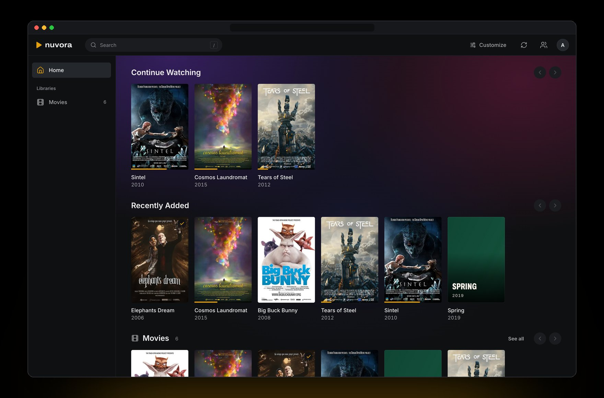
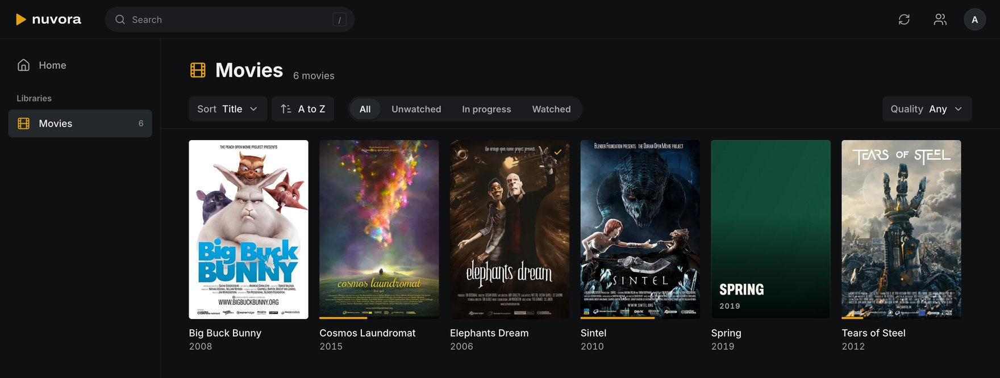
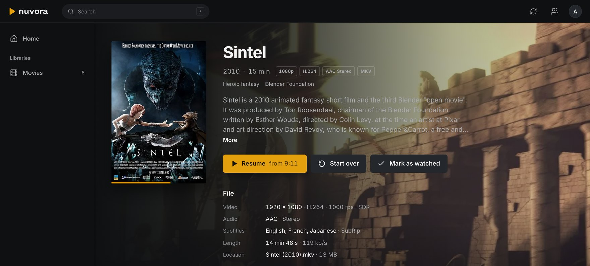
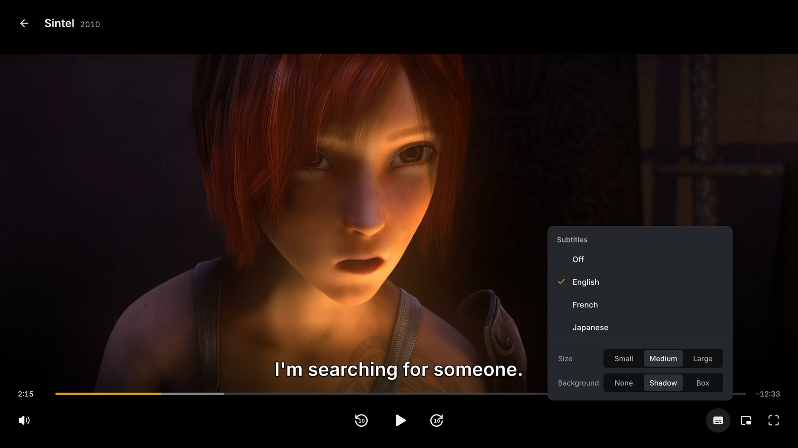

<p align="center">
  <a href="https://getnuvora.online">
    <picture>
      <source media="(prefers-color-scheme: dark)" srcset="assets/brand/nuvora-dark.svg">
      
    </picture>
  </a>
</p>

<p align="center">
  A media server for the movies, shows and anime you already have.<br>
  Plex's polish, Jellyfin's freedom, and no account with anyone but you.
</p>

<p align="center">
  <a href="https://getnuvora.online"><b>Website</b></a> &nbsp;·&nbsp;
  <a href="#set-up-your-server"><b>Install</b></a> &nbsp;·&nbsp;
  <a href="#watch-on-your-tv"><b>TV app</b></a> &nbsp;·&nbsp;
  <a href="#on-your-mac-or-pc"><b>Mac and Windows apps</b></a> &nbsp;·&nbsp;
  <a href="https://github.com/IuCC123/nuvora/releases/latest"><b>Latest release</b></a>
</p>

<p align="center">
  
</p>

Nuvora runs on a computer in your home, whether that's a PC, a Mac, a NAS or a Raspberry Pi, and turns a folder of video files into something that feels like a streaming service. Everyone in the house signs in with their own account and gets their own Continue Watching and their own Home screen. It's free and open source, and there's no Nuvora account, no subscription and nothing phoning home.

## What it does

### Finds everything on its own

Point it at a folder and it works out which files are movies, shows and episodes, then fills in posters, descriptions, cast and voice actors from Wikipedia, AniList and TVmaze. None of that needs an API key. A film with no artwork anywhere gets a designed title card instead of a random video frame.



### Plays almost anything

If your browser or TV can play a file as it is, that's what it gets, HEVC, HDR and surround sound included. If it can't, Nuvora converts only the part that needs it while you watch, which is often just the audio, and it uses the graphics chip when there is one. You can still jump to any point.



### Subtitles that behave

Embedded tracks show up, and so do `.srt`, `.ass` and `.vtt` files sitting next to the video. Styled anime subtitles keep their own fonts and placement, and Nuvora remembers which track you picked for each show.



### Watch together

Invite someone and play the same thing on two screens at the same moment, in the same house or across town. Pause, skip ahead or move on to the next episode, and the other screen follows.

There are TV apps too: one for Fire TV, Android TV and Google TV, and one for Fire TVs with Vega OS.

## Set up your server

Nuvora runs in Docker, so it works the same everywhere. Setting it up takes about five minutes.

### 1. Run the installer

On **macOS or Linux**, run this in a terminal:

```sh
curl -fsSL https://getnuvora.online/install.sh | bash
```

On **Windows**, run this in PowerShell:

```powershell
irm https://getnuvora.online/install.ps1 | iex
```

It checks for Docker first. On Linux it offers to install it, on a Mac it opens Docker Desktop's download and carries on once Docker runs, and on Windows it installs Docker Desktop with winget. Then it asks one thing, the folder with your movies and shows, and suggests folders that hold videos. It starts Nuvora in `~/nuvora` on port 8640, or the next free port. To answer up front, pass options: `curl -fsSL https://getnuvora.online/install.sh | bash -s -- --media ~/Media` (`--help` lists them all).

On **a NAS** (Synology, Unraid, TrueNAS and the like) **or by hand**, use Docker Compose. Make a folder called `nuvora`, save [`compose.yaml`](compose.yaml) in it, and create a file called `.env` next to it:

```sh
# The folder with your movies and shows. Nuvora only reads it.
NUVORA_MEDIA=D:/Media
```

On Linux, also add `NUVORA_UID=` and `NUVORA_GID=` lines with the output of `id -u` and `id -g`, so Nuvora can write to its `data` folder. The installer does this for you. Then, in that folder:

```sh
docker compose up -d
```

### 2. Create your account

Open **http://your-server:8640** in a browser. The installer prints the exact address, and on the same computer it's http://localhost:8640. The first visit asks you to create the admin account and then a library: give it a name, choose **Movies** or **Shows**, and pick its folder under `/media`, which is the media folder you gave the installer.

### 3. Add everyone else

In **Settings › Users**, add an account for each person. They can sign in from any browser on your network at the same address, or from the TV app.

## Watch on your TV

The TV app runs on Amazon Fire TV, Android TV and Google TV. It has everything the web app has for watching: Home, your libraries, search, subtitles (styled anime ones too), audio tracks, Continue Watching and Watch Together. It tells the server what the TV can decode, so most files play untouched, HEVC, HDR and surround sound included.

**On a Fire TV:**

1. Install **Downloader** (by AFTVnews) from the Amazon Appstore.
2. Let it install apps: go to **Settings › My Fire TV › Developer options › Install unknown apps** and turn on Downloader. No Developer options? Open **Settings › My Fire TV › About**, press OK on the device name seven times, and look again.
3. Open Downloader and enter your server's address followed by **/tv**, for example `http://192.168.1.20:8640/tv`. It downloads the newest TV app; choose **Install**.
4. Open **Nuvora**. Your server shows up under **On your network**: pick it and sign in. If it isn't there, type its address instead (`192.168.1.20` is enough when it uses port 8640).

When Nuvora runs on the same network, the TV finds the server by itself, and finds it again if its address changes. With Docker that needs host networking, which works on Linux; see the note in [`compose.yaml`](compose.yaml). Otherwise you type the address once.

**On Android TV or Google TV**, it's the same, with Downloader from the Play Store. Allow it to install apps when the TV asks.

To update the app, repeat step 3 and you stay signed in. The app is also on the [Releases](https://github.com/IuCC123/nuvora/releases/latest) page as `nuvora-tv.apk`.

**On a Fire TV with Vega OS** (the Fire TV Stick 4K Select): Android apps don't run there, so Nuvora has a separate Vega app. It has Home, your libraries, search, movie and show pages, subtitles, Continue Watching and Watch Together, and it finds your server on the network. Amazon only lets you install it from a computer:

1. Register the stick as a developer device in your Amazon developer account, then turn on **Settings › My Fire TV › Developer options › Developer Mode** (press OK on the device name in **About** seven times if you don't see Developer options).
2. Install Amazon's [Vega SDK](https://developer.amazon.com/docs/vega/latest/install-vega-sdk.html) and connect the stick over USB.
3. Download `nuvora-vega_armv7.vpkg` from [Releases](https://github.com/IuCC123/nuvora/releases/latest) and run `vega device install-app --packagePath nuvora-vega_armv7.vpkg`.
4. Open **Nuvora** and pick your server, or type its address.

## On your Mac or PC

Any browser works: open your server's address, like `http://192.168.1.20:8640`. The Nuvora app for Mac and Windows is the same app in its own window. It runs on the system's own web engine (Safari's on a Mac, Edge's on Windows), so it is small, and it shows exactly what the browser shows, straight from your server. It finds servers on your network, remembers yours, and updates itself.

- **Mac** (macOS 12.3 or later, Apple silicon and Intel): download [`Nuvora-mac.dmg`](https://github.com/IuCC123/nuvora/releases/latest/download/Nuvora-mac.dmg), open it and drag Nuvora to Applications. The app isn't notarized by Apple yet, so the first time, macOS refuses to open it: go to **System Settings › Privacy & Security**, scroll down and choose **Open Anyway**.
- **Windows** (10 or 11): download [`Nuvora-windows-setup.exe`](https://github.com/IuCC123/nuvora/releases/latest/download/Nuvora-windows-setup.exe) and run it. If SmartScreen warns about an unrecognized app, choose **More info › Run anyway**.

Open Nuvora, pick your server under **On your network** (or type its address) and sign in. **Switch server** is in the account menu, and in the Mac's Nuvora menu. When a new version of the app is out, it offers to update and restart; **Settings › Account › This app** checks by hand.

## Organizing your files

Nuvora goes by folder and file names, so a little order goes a long way:

```text
Media/
├── Movies/
│   └── Big Buck Bunny (2008)/
│       ├── Big Buck Bunny (2008).mkv
│       └── Big Buck Bunny (2008).en.srt
└── Shows/
    └── Tower of God/
        └── Season 02/
            └── Tower of God - S02E01.mkv
```

Movies want a year in the name. Episodes want a number: `S02E01`, `2x01` and anime-style `Show - 01 [1080p].mkv` all work. Subtitle files next to a video are picked up along with their language (`.en.srt`, `.English.forced.srt`, or a `Subs/` folder).

## Updating

When a new version is out, admins see it in the web app and the Mac and Windows apps. **Settings › General › Update and restart** downloads it, checks it, and restarts the server as the new version; open pages reload by themselves. With Docker, the new server is kept in the `data` folder and the container keeps using it, so it survives restarts; pulling a newer image later replaces it.

You can also update by hand: run the installer again, which keeps your answers and says which version you moved to, or do this in the folder with `compose.yaml`, which also brings the newest FFmpeg:

```sh
docker compose pull && docker compose up -d
```

Accounts, progress and settings carry over. To stay on one version, set `NUVORA_IMAGE=ghcr.io/iucc123/nuvora:0.4.0` and `NUVORA_UPDATES=false` in `.env`, or pass `--version 0.4.0` to the installer.

To remove Nuvora, run `curl -fsSL https://getnuvora.online/install.sh | bash -s -- --uninstall`. It stops and removes Nuvora and asks before deleting its data.

To back up, copy the `data` folder next to `compose.yaml` (`~/nuvora/data` if you used the installer) while Nuvora is stopped. Everything Nuvora knows lives there.

## Settings

Set these in `.env` next to `compose.yaml`, then run `docker compose up -d`:

| Setting | Default | |
|---|---|---|
| `NUVORA_MEDIA` | (required) | Your media folder, mounted read-only at `/media` |
| `NUVORA_PORT` | `8640` | Port on this machine |
| `NUVORA_LISTEN` | `0.0.0.0` | `127.0.0.1` to accept connections from this machine only (behind a reverse proxy) |
| `NUVORA_IMAGE` | `ghcr.io/iucc123/nuvora:latest` | Image and version to run |
| `NUVORA_UID`, `NUVORA_GID` | `10001` | User and group Nuvora runs as; must be able to read your media and write `data` (the installer sets yours) |
| `NUVORA_TRUSTED_PROXY` | | Your reverse proxy's address or network, see [Remote access](#remote-access) |
| `NUVORA_HARDWARE_ENCODING` | `auto` | Convert video on the graphics chip when one works: `auto`, `off`, or `videotoolbox`, `nvenc`, `vaapi` |
| `NUVORA_UPDATES` | `true` | Look for new versions on GitHub so admins can update from Settings; `false` and the server never contacts GitHub (update by hand) |
| `TZ` | `UTC` | Time zone, for example `Europe/Amsterdam` |

The image is published for x86-64 and ARM64, which covers the Raspberry Pi 4 and 5, Apple Silicon and most recent NAS boxes.

### Converting on the graphics chip

Most of the time a device plays your files as they are. When it can't, because of a codec the TV lacks or a bitrate too high for the network, Nuvora converts the video as it plays. By default it does that on the graphics chip when one works, which takes far less processor time: Apple's VideoToolbox on a Mac, NVIDIA's NVENC, or VA-API for Intel and AMD graphics on Linux. It tries each one at startup with a short test clip and falls back to the processor (x264) when none works. **Settings › General** shows which one is in use.

Converted video keeps the file's own resolution, up to 4K, unless the device can't play that much. Converting 4K on the processor needs a fast one, so on a Raspberry Pi or a small NAS those files may stutter.

In Docker, the container needs the graphics chip passed in; see the commented lines in [`compose.yaml`](compose.yaml). Without them, Nuvora converts on the processor.

## Remote access

Everything needs a sign-in, so you can let friends reach your server from outside your home. The easiest way is a private network such as [Tailscale](https://tailscale.com): install it on the server and on their device. The other way is a reverse proxy with HTTPS, such as Caddy, nginx or Traefik. Don't forward port 8640 straight to the internet; without HTTPS, passwords and session cookies cross the network in plain text.

When a reverse proxy on the same machine is the only way in, publish Nuvora on loopback so nothing else can reach it directly: set `NUVORA_LISTEN=127.0.0.1` (or pass `--listen 127.0.0.1` to the installer) and run `docker compose up -d` again.

The proxy has to pass on the original host and scheme, the client's address, and WebSocket upgrades, which Watch Together uses:

```nginx
location / {
    proxy_pass http://127.0.0.1:8640;
    proxy_http_version 1.1;
    proxy_set_header Upgrade $http_upgrade;
    proxy_set_header Connection "upgrade";
    proxy_set_header Host $host;
    proxy_set_header X-Forwarded-Proto $scheme;
    proxy_set_header X-Forwarded-For $proxy_add_x_forwarded_for;
}
```

Then tell Nuvora to trust the proxy with `NUVORA_TRUSTED_PROXY`, set to an address or CIDR block (comma-separated for more than one). Sign-in limits then apply to each client's address instead of to the proxy's, and requests are checked against the host in `X-Forwarded-Host` when the proxy sends one. In Docker, the proxy's requests arrive from the Compose network's gateway, so trust that network, usually `NUVORA_TRUSTED_PROXY=172.16.0.0/12`. Only do this together with `NUVORA_LISTEN=127.0.0.1`, or anyone who can reach the port could claim any address.

## Development

You need [Rust](https://rustup.rs) (stable), [Bun](https://bun.sh) 1.3 and FFmpeg 6 or newer.

```sh
bun install
bun run build                                   # the web app, which the server embeds
cargo run -p nuvora-server -- --data-dir ./data # http://localhost:8640
bun run dev                                     # web app with hot reload, proxying /api to :8640
```

The code is split like this: `crates/` is the server (`media` knows files, `library` owns the database, `server` is the HTTP API), `packages/core` is the TypeScript data layer, `apps/web` is the web app, `apps/firetv` is the TV app, and `apps/vega` is the Vega OS app.

The TV app is written in Kotlin with Jetpack Compose for TV. With JDK 17+ and the Android SDK, run `./gradlew installDebug` in `apps/firetv` to build it and install it on a connected TV or emulator.

The Vega OS app is in `apps/vega` (React Native for Vega, sharing `packages/core` with the web app). With the [Vega SDK](https://developer.amazon.com/docs/vega/latest/install-vega-sdk.html), `npm install` there (it also builds Shaka Player with Amazon's patches) and `npm run build:release` makes `build/<arch>-release/nuvora-vega_<arch>.vpkg`: `armv7` for Fire TV devices, `aarch64` or `x86_64` (your Mac's) for the Vega Virtual Device, where `vega run-app build/aarch64-release/nuvora-vega_aarch64.vpkg app.nuvora.vega.main -d VirtualDevice` runs it. The virtual device claims to decode HEVC but can't; the app notices and asks the server for H.264 instead.

To keep a build running on a Mac without Docker, `scripts/macos-service.sh install --bin target/release/nuvora --data-dir ~/Nuvora` makes it a background service that starts when you log in and restarts if it stops. `status` and `uninstall` do what they say.

Tests: `cargo test --workspace` and `bun test`, `bun run typecheck` for TypeScript, `./gradlew testDebugUnitTest` in `apps/firetv`, and `./gradlew connectedDebugAndroidTest` there with an emulator running. After changing the API, `bun run gen:api` regenerates the TypeScript client's types. To try the Docker image from your checkout, run `scripts/install.sh --build`.

## Credits

Nuvora stands on [FFmpeg](https://ffmpeg.org), [JASSUB](https://github.com/ThaUnknown/jassub) and [hls.js](https://github.com/video-dev/hls.js), among others; see [THIRD_PARTY_NOTICES.md](THIRD_PARTY_NOTICES.md). Descriptions and artwork come from [Wikipedia](https://www.wikipedia.org) and [Wikidata](https://www.wikidata.org), [AniList](https://anilist.co), [TVmaze](https://www.tvmaze.com) and, with your own key, [TMDB](https://www.themoviedb.org).

The screenshots show Blender's open movies Sintel, Big Buck Bunny, Tears of Steel and Cosmos Laundromat (© Blender Foundation) and Elephants Dream (© Orange Open Movie Project), all under [Creative Commons Attribution](https://creativecommons.org/licenses/by/3.0/). The wordmark is set in [Archivo](https://github.com/Omnibus-Type/Archivo) (SIL Open Font License).

## License

Nuvora is free software under the [GNU Affero General Public License v3.0](LICENSE). You can use it, change it and share it. If you share a changed version, or run one that other people use over a network, you have to offer them its source under the same license.
